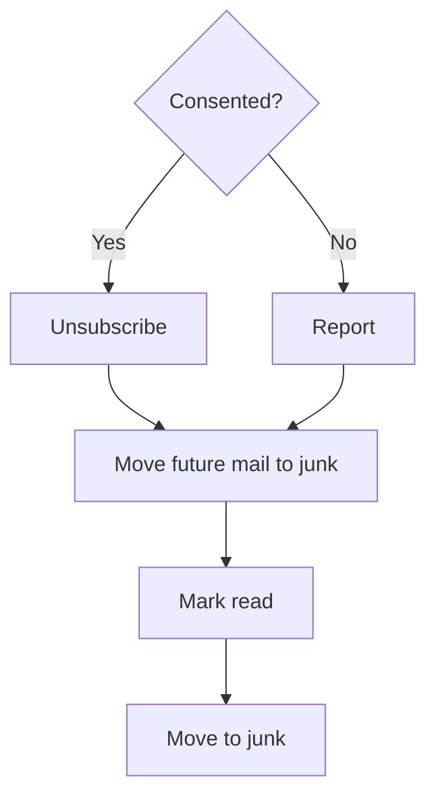

# Spamhammer

After a successful unsubscribe or report, mark matching inbox messages read and move them to junk.
The subject substring selects the message used to unsubscribe; it does not limit cleanup. Dry runs
inspect headers without changing flags or folders. `block` routes future matching mail to junk with
a Sieve rule, keeping messages recoverable rather than rejecting or deleting them.

```bash
python -m manage junk_email MileagePlus_Partner@enews.united.com --dry-run --folder Spam
python -m manage junk_email MileagePlus_Partner@enews.united.com --folder Spam
```

Set `SPAMHAMMER_JUNK_FOLDER` for automatic cleanup; otherwise the destination is `Spam`. The folder
must already exist, and the server must support UID MOVE. A failed move can leave matching
messages read or partially moved; rerun cleanup after fixing the cause. No broad EXPUNGE is issued,
and unrelated flags are preserved.

## Cleanup scope

Count dots in the domain after `@`:

* Two or more dots: clean up the exact subdomain, including every sender on it
* Fewer than two dots: clean up only the exact sender

IMAP substring search finds candidates; parsed From addresses must match the inferred scope before
any message changes. Deeper subdomains and similar-looking addresses are excluded. This rule counts
dots literally, including public suffixes such as `co.uk`.

```text
Moved 96 messages from enews.united.com to Spam: MileagePlus_Partner@, unitedairlines@, MyMileagePlus@, MileagePlus_Program@
Moved 10 messages from sender@one.domain to Spam
```

Dry runs use `Would move` instead of `Moved`. Domain output lists each affected sender once.

Mail-routing rules should record their scope, creation time, and last match. Review quiet rules
periodically; zero inbox messages alone does not prove a rule is unused. Retiring a rule can let
future mail reach inbox again.
