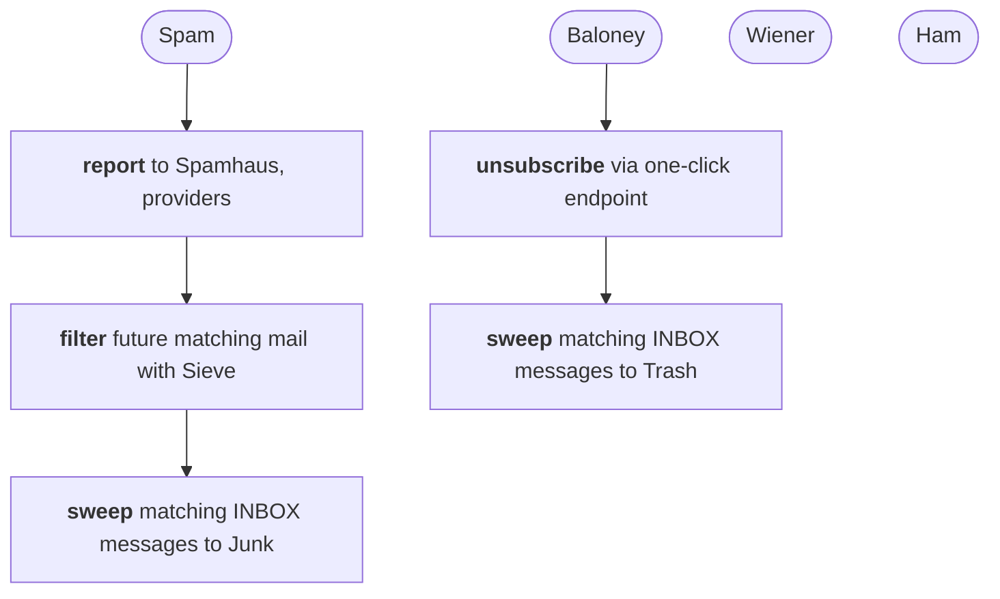

* **Spam**: Did not provide email. Swing the (report and filter) hammer and sweep to Junk.
* **Baloney**: Provided email and might have (accidentally or under coupon duress) opted in.
  Unsubscribe and sweep to Trash.
* **Wiener**: Transactional email with potentially useful information like purchase price,
  delivery date, or both. TODO migrate and automate manual cashcal/finctrl rules.
* **Ham**: From a real person wanting to converse. TODO add them to the address book as needed.
  Remain vigilant for chain mail and account takeover misbehavior.
